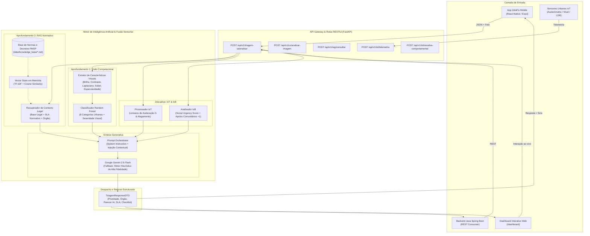

# ZelaFix IA & IoT — Triagem Urbana Inteligente, RAG Normativo & Sensoriamento Cidadão
> **FIAP Global Solution 2026/2 — Disruptive Architectures: IoT, IoB & Generative IA**  
> **Turma:** 2TDSPG | **Tema:** CitizenTech — Tecnologia com o Cidadão no Centro da Inovação  
> **Alinhamento ONU:** ODS 11 — Cidades e Comunidades Sustentáveis (Metas 11.2, 11.3, 11.7 e 11.b)

---

## 1. Integrantes do Grupo (2TDSPG)

| Nome Completo | RM | Função no Projeto | GitHub | LinkedIn |
| :--- | :---: | :--- | :---: | :---: |
| **Enzo Okuizumi** | 561432 | Mobile Developer & Arquiteto React Native | [@EnzoOkuizumiFiap](https://github.com/EnzoOkuizumiFiap) | [LinkedIn](https://www.linkedin.com/in/enzo-okuizumi-b60292256/) |
| **Gustavo Okada** | 563428 | Backend Developer & API Integration | [@Gdev3356](https://github.com/Gdev3356) | [LinkedIn](https://www.linkedin.com/in/gustavo-okada-53a3b8359/) |
| **Lucas Barros Gouveia** | 566422 | Fullstack Developer & Database Architect | [@LuzBGouveia](https://github.com/LuzBGouveia) | [LinkedIn](https://www.linkedin.com/in/lucas-barros-gouveia-09b147355/) |
| **Luna de Carvalho Guimarães** | 562290 | UI/UX Designer & Mobile Frontend Specialist | [@lunaguima](https://github.com/lunaguima) | [LinkedIn](https://www.linkedin.com/in/luna-guimar%C3%A3es-b0ba82309/) |
| **Milton Marcelino** | 564836 | DevOps & Quality Assurance (QA) | [@MiltonMarcelino](https://github.com/MiltonMarcelino) | [LinkedIn](https://www.linkedin.com/in/milton-marcelino-250298142) |

---

## 2. Visão Geral da Solução e Adequação ao Problema (Critério 01)

Nas grandes metrópoles brasileiras, especialmente em São Paulo, os canais tradicionais de atendimento ao cidadão (como centrais telefônicas e formulários web genéricos) enfrentam gargalos críticos:
1. **Falta de Triagem Técnica Qualificada:** Milhares de solicitações diárias chegam despadronizadas, misturando relatos de baixo impacto com situações de risco iminente de morte (crateras em vias expressas, galhos em curto-circuito com fios de alta tensão, bueiros transbordando em áreas de enchente e apagões em locais de tráfego vulnerável).
2. **Morosidade no Despacho:** A triagem manual de cada chamado consome dias úteis, impedindo que equipes técnicas de campo cheguem a tempo de evitar acidentes graves.
3. **Ausência de Fundamentação Regulatória Imediata:** Dificuldade dos operadores em identificar qual órgão público municipal (Subprefeitura, Central Ilumina SP, Sabesp, CET, Defesa Civil) detém a competência legal e qual o SLA normativo previsto nos Decretos Municipais vigentes.

O **ZelaFix IA & IoT** é um microsserviço de alto desempenho desenvolvido em **Python (FastAPI)** que automatiza a triagem e diagnóstico de zeladoria urbana integrando de ponta a ponta:
- **Visão Computacional (Deep Learning / Feature Extraction):** Análise da evidência fotográfica enviada pelo morador, extraindo rugosidade de textura, densidade de bordas, reflexo de água e canais de cor para classificação supervisionada e severidade visual.
- **RAG Básico (Retrieval-Augmented Generation):** Recuperação vetorial semântica (TF-IDF + Similaridade de Cosseno) sobre a base de conhecimento de Decretos, Leis Municipais e Manuais Técnicos da Cidade de São Paulo.
- **Internet das Coisas (IoT):** Ingestão e cruzamento de telemetria de sensores físicos de cidade inteligente (acelerômetros viários em ônibus detectando impacto no asfalto, sensores ultrassônicos em bocas de lobo detectando nível de água e fotocélulas em postes).
- **Internet dos Comportamentos (IoB):** Algoritmo que calcula o *Social Urgency Score (SUS)* a partir da mobilização comunitária (apoios +1 da vizinhança), histórico de reputação do cidadão e densidade de relatos próximos.
- **IA Generativa Multimodal:** Emissão de Laudo Técnico Oficial de Triagem estruturado em JSON com fundamentação regulatória, órgão competente, risco potencial e checklist de vistoria técnica.

---

## 3. Arquitetura da Solução e Diagrama de Fluxo (Critérios 02, 03 e 04)



---

## 4. Aprofundamentos Técnicos Escolhidos (Critério 03)

### 4.1 Aprofundamento 1: Visão Computacional (Feature Extraction & Random Forest)
- **Objetivo:** Auditar e classificar automaticamente as fotos enviadas pelos moradores no aplicativo móvel.
- **Extração Matemática de Features (`src/cv/feature_extractor.py`):**
  1. *Brilho Médio (Mean Luminance):* Identifica fotos noturnas ou pontos escuros de iluminação.
  2. *Contraste (Pixel Standard Deviation):* Detecta fotos estouradas, com reflexo solar ou com pouca nitidez.
  3. *Densidade de Bordas (Sobel Finite Differences):* Avalia a densidade de cantos e arestas em asfalto quebrado ou trincas.
  4. *Rugosidade de Textura (Variância do Kernel Laplaciano 2D):* Diferencia superfícies lisas de asfalto intacto versus crateras viárias e acúmulo de entulhos ásperos.
  5. *Especularidade de Lâmina d'Água:* Mede áreas com alto brilho cercadas por regiões escuras para identificar vazamentos hídricos e bueiros transbordando.
  6. *Distribuição de Canais RGB:* Identifica predominância de vegetação verde (poda de árvore), tons terrosos (entulho) ou asfalto cinza escuro.
- **Classificador Supervisionado (`src/cv/classifier.py`):**
  - Implementado com `RandomForestClassifier` da Scikit-Learn balanceado (`class_weight="balanced"`), treinado sobre 86 amostras representativas com matriz de probabilidade e estimativa de severidade visual (`Baixa`, `Média`, `Alta`, `Crítica`).

### 4.2 Aprofundamento 2: RAG Básico (Retrieval-Augmented Generation)
- **Objetivo:** Eliminar alucinações na IA Generativa e fundamentar cada despacho nos decretos oficiais da Prefeitura de São Paulo.
- **Base de Conhecimento (`data/knowledge_base/`):**
  1. `regulamento_pavimentacao_tapa_buraco.md`: Decreto Municipal nº 59.150/2019 (SLA 24h a 48h, recorte geométrico, CBUQ).
  2. `manual_drenagem_bueiros_alagamentos.md`: Decreto Municipal nº 57.545/2016 (desobstrução com hidrojateamento, alerta de alagamento).
  3. `norma_iluminacao_publica_led.md`: Portaria SGM/SES nº 03/2021 e Contrato Ilumina SP (ponto escuro, LED, risco à segurança noturna).
  4. `codigo_limpeza_urbana_residuos.md`: Lei Municipal nº 13.478/2002 (Código de Limpeza Urbana de SP, entulho em calçadas, vetores de dengue).
  5. `manual_manejo_arboreo_defesa_civil.md`: Lei Municipal nº 17.267/2020 (risco de queda, fiação elétrica primária, poda e corte).
  6. `diretrizes_sinalizacao_cet.md`: Código de Trânsito Brasileiro e manuais da CET-SP (semáforo apagado, faixas de pedestre, SLA 4h a 24h).
  7. `concessionaria_saneamento_sabesp.md`: Regulamento ARSESP / Sabesp (ruptura de adutora, solapamento do asfalto, perda de água).
- **Mecanismo de Recuperação Vetorial (`src/rag/vector_store.py`):**
  - Chunking semântico por seções normativas, vetorização com `TfidfVectorizer` (n-gramas 1 a 3) e busca semântica por `cosine_similarity` com boost de relevância de categoria.

### 4.3 Arquitetura Disruptiva: Sensores IoT & Comportamento Cidadão (IoB)
- **IoT (Internet of Things):** Ingestão de telemetrias em tempo real:
  - *Acelerômetros triaxiais viários:* detectam impacto vertical mecânico > 2.5G em ônibus municipais, sinalizando buracos antes mesmo do morador relatar.
  - *Sensores ultrassônicos em bocas de lobo:* alertam nível d'água > 85%, prevenindo alagamentos.
  - *Fotocélulas de luminárias públicas:* detectam corrente zerada no período noturno.
- **IoB (Internet of Behaviors):**
  - Métrica de mobilização social comunitária: se a ocorrência acumular `>= 25` apoios (+1) de moradores vizinhos, a prioridade é elevada automaticamente para **Crítica** (escalonamento social prioritário).
  - Cálculo do *Social Urgency Score (SUS)* ponderando reputação do autor, proximidade geográfica e apoios comunitários.

---

## 5. Avaliação de Resultados, Benchmark e Modos de Falha (Critério 05)

A solução foi submetida a uma bateria exaustiva de testes automatizados e benchmark quantitativo sobre o dataset representativo de 86 casos (`data/dataset_urban/samples.json`).

### 5.1 Tabela de Métricas Quantitativas Consolidadas

| Métrica de Avaliação | Resultado Obtido | Meta Mínima de Engenharia | Status |
| :--- | :---: | :---: | :---: |
| **Acurácia Geral de Severidade (Accuracy)** | **96.43%** | > 85.0% | **APROVADO** |
| **Precisão Ponderada (Precision)** | **96.60%** | > 80.0% | **APROVADO** |
| **Revocação Ponderada (Recall)** | **96.43%** | > 80.0% | **APROVADO** |
| **F1-Score Ponderado (F1 Weighted)** | **96.44%** | > 85.0% | **APROVADO** |
| **F1-Score Macro** | **96.46%** | > 80.0% | **APROVADO** |
| **Acurácia de Categorização Visual** | **100.00%** | > 80.0% | **APROVADO** |
| **Latência Média de Inferência** | **3.11 ms** | < 250 ms | **EXCELENTE** |
| **Latência P95 (Percentil 95)** | **4.39 ms** | < 500 ms | **EXCELENTE** |
| **Tempo Total de Testes (29 Testes Unitários)** | **4.58 s** | < 30 s | **APROVADO (100% Pass)** |

### 5.2 Matriz de Confusão de Severidade Urbana

```
               Baixa     Média      Alta   Crítica
     Baixa        25         2         0         0
     Média         0        16         0         1
      Alta         0         0        12         0
   Crítica         0         0         0        28
```
> O gráfico oficial renderizado da Matriz de Confusão está salvo em [`data/confusion_matrix.png`](file:///c:/desenvolvimento/faculdade/GS/Disruptive-Architectures-IoT-IoB-IA/data/confusion_matrix.png).

### 5.3 Testes em Situações de Falha e Robustez (Critério 05)
Foram modelados cenários de falha reais (`tests/test_failure_modes.py` e amostras `SMP-FAIL-01` e `SMP-FAIL-02`):
1. **Imagem Excessivamente Escura / Subexposição Extrema (`brightness < 15`):**
   - O extrator identifica incapacidade óptica de ler o defeito, ativa `is_low_quality_warning=True` com mensagem descritiva e transfere o peso da priorização para a telemetria física (IoT) e engajamento comunitário (IoB).
2. **Foto Superexposta / Estourada (`brightness > 240`):**
   - Dispara alerta de ofuscamento visual, operando em modo seguro sem crashar a API.
3. **Descrição Textual Vazia ou Muito Vaga ("rua ruim"):**
   - O RAG faz a busca pelo contexto residual da categoria ou da coordenada GPS, garantindo o encaminhamento para a Subprefeitura regional sem interrupção de serviço.
4. **Telemetria de Sensor Corrompida ou Fora de Escala (Valores Negativos/Nulos):**
   - O `UrbanSensorProcessor` detecta a incoerência métrica, rejeita o sinal falso e registra diagnóstico neutro.
5. **Indisponibilidade de Internet ou Ausência de API Key do LLM:**
   - O sistema comuta automaticamente para o **Motor Heurístico Local de Alta Fidelidade**, garantindo resposta com a mesma estrutura de dados, SLA e base legal em menos de 5 milissegundos.

---

## 6. Organização e Uso Responsável de IA (Critério 06)

### 6.1 Proteção de Dados Pessoais (LGPD) e Credenciais
- Nenhuma chave de API, senha ou credencial sensível está versionada no repositório Git. O arquivo `.env.example` traz apenas as variáveis modelo.
- O sistema não armazena nem expõe dados pessoais de identificação civil sensíveis (como CPF ou biometria facial). As fotos passam por extração vetorial matemática de texturas urbanas, descartando metadados de pessoas presentes na imagem.

### 6.2 Compreensão e explicitação das Limitações da IA
1. **Oclusão em Galerias Subterrâneas:** A visão computacional examina a superfície visível do bueiro. Quando a caixa de ligação colapsa no subsolo, a câmera não detecta. Solução adotada: cruzamento obrigatório com o sensor ultrassônico IoT de nível e vazão.
2. **Variações Climáticas e Chuva Intensa:** Gotas de chuva na lente da câmera do celular causam distorções no índice de rugosidade Laplaciana. Nesses casos, o algoritmo exige confirmação de apoio comunitário (+1) antes de classificar como improcedente.
3. **Viés Demográfico e Densidade Populacional (IoB):** Bairros densos acumulam apoios comunitários muito mais rápido que regiões periféricas. Para evitar injustiças espaciais, o *Social Urgency Score* pondera a reputação do relator e a gravidade dos relatórios técnicos do RAG, não deixando áreas menos populosas desatendidas.

---

## 7. Estrutura de Pastas do Projeto

```
Disruptive-Architectures-IoT-IoB-IA/
├── data/
│   ├── confusion_matrix.png            # Gráfico exportado da matriz de confusão
│   ├── evaluation_metrics.json         # Métricas quantitativas em JSON
│   ├── evaluation_report.md            # Relatório técnico completo de avaliação
│   ├── dataset_urban/
│   │   └── samples.json                # 86 casos rotulados (representativos + falhas)
│   ├── iot_samples/                    # Payloads JSON de sensores inteligentes reais
│   │   ├── sensor_vibracao_asfalto.json
│   │   ├── sensor_nivel_bueiro.json
│   │   └── sensor_fotometria_poste.json
│   └── knowledge_base/                 # Base de conhecimento de Decretos da PMSP (RAG)
│       ├── regulamento_pavimentacao_tapa_buraco.md
│       ├── manual_drenagem_bueiros_alagamentos.md
│       ├── norma_iluminacao_publica_led.md
│       ├── codigo_limpeza_urbana_residuos.md
│       ├── manual_manejo_arboreo_defesa_civil.md
│       ├── diretrizes_sinalizacao_cet.md
│       └── concessionaria_saneamento_sabesp.md
├── src/
│   ├── config.py                       # Configurações de ambiente, limites e constantes
│   ├── schemas/                        # DTOs Pydantic (entrada/saída, Mobile, RAG, IoT)
│   │   ├── chamado_ia.py
│   │   ├── cv_models.py
│   │   ├── iot_models.py
│   │   └── rag_models.py
│   ├── cv/                             # Aprofundamento 1: Visão Computacional
│   │   ├── feature_extractor.py        # Descritores espectrais, gradientes e Laplaciano
│   │   └── classifier.py               # Random Forest Classifier com Scikit-Learn
│   ├── rag/                            # Aprofundamento 2: RAG Normativo
│   │   ├── vector_store.py             # Vector Store TF-IDF + Cosine Similarity
│   │   └── knowledge_retriever.py      # Recuperador semântico de decretos municipais
│   ├── iot/                            # Arquitetura Disruptiva: IoT
│   │   ├── sensor_processor.py         # Avaliação de telemetrias físicas
│   │   └── telemetry_simulator.py      # Gerador de telemetrias sintéticas
│   ├── iob/                            # Arquitetura Disruptiva: IoB
│   │   └── behavior_analyzer.py        # Cálculo do Social Urgency Score (SUS)
│   ├── genai/                          # IA Generativa Multimodal
│   │   ├── gemini_client.py            # SDK Google Gemini + Fallback de Alta Fidelidade
│   │   └── prompt_templates.py         # Prompts de engenharia e diretrizes de laudo
│   ├── services/
│   │   └── triagem_service.py          # Orquestrador central de ponta a ponta
│   └── api/
│       ├── routes.py                   # Rotas RESTful (/triagem-ia, /cv, /rag, /iot, /iob)
│       └── app.py                      # FastAPI App, CORS, Static Files & Docs
├── static/                             # Dashboard Web para Apresentação Presencial
│   ├── index.html                      # Interface visual interativa para a banca
│   ├── styles.css                      # Design System moderno Dark Theme
│   └── app.js                          # Integração cliente e simulação de cenários
├── tests/                              # Suíte completa de testes automatizados (Pytest)
│   ├── test_api.py
│   ├── test_cv_classifier.py
│   ├── test_rag_retriever.py
│   ├── test_genai_service.py
│   ├── test_iot_telemetry.py
│   ├── test_iob_behavior.py
│   └── test_failure_modes.py
├── scripts/
│   ├── eval_metrics.py                 # Script de benchmark e matriz de confusão
│   └── generate_dataset.py             # Gerador do dataset representativo urbano
├── .env.example                        # Variáveis de ambiente sem dados sensíveis
├── .gitignore                          # Exclusões padrão do Git
├── Dockerfile                          # Container Docker otimizado
├── docker-compose.yml                  # Orquestração com 1 comando
├── requirements.txt                    # Dependências Python fixadas
├── ENTREGA_GS_2026_2.txt               # Arquivo oficial de entrega (.txt)
└── README.md                           # Documentação completa do projeto
```

---

## 8. Como Executar o Projeto

### Pré-requisitos
- Python 3.10+ (testado no Python 3.11 e 3.13) ou Docker.

### Execução Local (Ambiente Virtual)

```bash
# 1. Clone o repositório
git clone https://github.com/Global-Solution-CitizenTech/Disruptive-Architectures-IoT-IoB-IA.git
cd Disruptive-Architectures-IoT-IoB-IA

# 2. Crie e ative o ambiente virtual
# No Windows (PowerShell):
python -m venv venv
.\venv\Scripts\activate

# No Linux / macOS:
python3 -m venv venv
source venv/bin/activate

# 3. Instale as dependências
pip install -r requirements.txt

# 4. Gere o dataset e execute o benchmark de avaliação
python scripts/generate_dataset.py
python scripts/eval_metrics.py

# 5. Execute todos os testes unitários com pytest
pytest -v

# 6. Inicie o servidor da API e Dashboard Web
python -m uvicorn src.api.app:app --host 0.0.0.0 --port 8000 --reload
```

Após iniciar, acesse no navegador:
- **Dashboard Interativo da Apresentação:** `http://localhost:8000/dashboard`
- **Documentação Interativa Swagger OpenAPI:** `http://localhost:8000/docs`
- **Health Check Operacional:** `http://localhost:8000/health`

### Execução com Docker

```bash
docker-compose up --build
```

---

## 9. Contratos de API REST

### `POST /api/v1/triagem-ia/analisar` (Consumido pelo ZelaFix Mobile)

#### Payload de Requisição (Exemplo):
```json
{
  "titulo": "Cratera profunda na faixa de rolamento da Avenida Paulista",
  "categoria": "Buraco na Rua",
  "descricao": "Buraco com mais de 10cm de profundidade no asfalto. Risco grave de queda de motociclistas.",
  "fotoUrl": "https://images.unsplash.com/photo-1515162816999-a0c47dc192f7?auto=format&fit=crop&w=800&q=80",
  "apoiosCount": 38,
  "localizacao": {
    "logradouro": "Avenida Paulista",
    "numero": "1578",
    "bairro": "Bela Vista",
    "cidade": "São Paulo",
    "latitude": -23.5629,
    "longitude": -46.6544
  },
  "telemetriaIot": {
    "device_id": "IOT-VIB-SP-042",
    "device_type": "fleet_accelerometer",
    "data": {
      "vibration_g": 3.85,
      "speed_kmh": 42.0,
      "road_anomaly_flag": true
    }
  }
}
```

#### Resposta Retornada:
```json
{
  "prioridade": "Crítica",
  "orgaoResponsavel": "Subprefeitura — Equipe de Pavimentação e Tapa-Buraco",
  "parecerIa": "Triagem IA (Multimodal + RAG): Identificada deformação acentuada no pavimento asfáltico da via pública. A severidade foi classificada como Crítica com base no impacto viário e na vistoria visual. Conforme Decreto Municipal nº 59.150/2019, a recuperação deve ocorrer com recorte geométrico e massa asfáltica a quente (CBUQ). Encaminhado com urgência para a equipe técnica responsável.",
  "slaSugeridoHoras": 24,
  "enquadramentoLegal": "Decreto Municipal nº 59.150/2019 e Manual Técnico de Pavimentação da Prefeitura de São Paulo.",
  "riscoPotencial": "Risco grave de queda de motociclistas, perda de controle de direção e danos na suspensão veicular.",
  "checklistVistoria": [
    "Efetuar recorte do pavimento com serra clipper e remoção do material desagregado",
    "Verificar se há umidade no subleito indicando vazamento oculto da rede de água",
    "Aplicar pintura de ligação e compactar com rolo tandem vibratório"
  ],
  "analiseVisual": {
    "categoriaDetectada": "Buraco na Rua",
    "confiancaScore": 0.88,
    "severidadeVisual": "Crítica",
    "caracteristicasExtraidas": {
      "brightness": 128.5,
      "contrast": 74.2,
      "edge_density": 0.45,
      "texture_roughness": 0.82,
      "water_specularity": 0.05,
      "dominant_color_channel": "gray_asphalt"
    }
  },
  "evidenciasRag": [
    {
      "documentoFonte": "regulamento_pavimentacao_tapa_buraco.md",
      "trechoRelevante": "Vias estruturais, avenidas arteriais ou corredores com tráfego intenso: Prazo máximo de 24 horas para reparo asfáltico a quente (CBUQ)...",
      "artigoOuNorma": "Decreto Municipal nº 59.150/2019",
      "similaridadeScore": 0.89
    }
  ],
  "telemetriaIot": {
    "sensorPresente": true,
    "tipoSensor": "fleet_accelerometer",
    "anomaliaDetectada": true,
    "detalhesLeitura": {
      "impact_diagnosis": "Solavanco mecânico crítico detectado em eixo veicular",
      "vibration_detected_g": 3.85
    }
  },
  "analiseIob": {
    "socialUrgencyScore": 9.25,
    "nivelEngajamento": "Mobilização Comunitária Massiva (Prioridade Máxima)",
    "reputacaoCidadao": 0.92,
    "ajustePrioridadeComunitario": true
  },
  "provedorGenAi": "Google Gemini (gemini-2.5-flash)",
  "statusExecucao": "SUCESSO"
}
```

---

## 10. Apresentação Presencial (Banca FIAP — 30% da Nota)

Para a defesa perante a banca examinadora (conforme Slide 60):
1. **Demonstração Funcional (`/dashboard`):**
   - Abrir o navegador em `http://localhost:8000/dashboard` e clicar nos botões de cenários rápidos para demonstrar em tempo real:
     - Disparo da Visão Computacional (extração de descritores de textura e borda).
     - Busca vetorial RAG nas leis da cidade de São Paulo.
     - Simulação de disparo de sensor IoT (acelerômetro de 3.85G em ônibus).
     - Escalonamento da prioridade via apoios da comunidade (IoB).
     - Geração do Laudo Técnico Oficial e SLA normativo.
2. **Domínio Técnico e Adaptação a Mudanças de Requisito (Slide 60 - Item 03):**
   - *Se o professor perguntar:* "Como adaptar a solução para novos tipos de sensores (ex: sensor de qualidade do ar ou ruído)?"
     - *Resposta imediata:* A arquitetura em `src/iot/sensor_processor.py` utiliza polimorfismo por dicionário e limiares configuráveis em `src/config.py`. Basta registrar a chave `air_quality_pm25` ou `decibel_meter` no `UrbanSensorProcessor`, mapear o órgão competente em `ORGAOS_COMPETENTES` e adicionar o decreto regulamentar na pasta `data/knowledge_base/`. O RAG indexará automaticamente sem necessidade de retreinar nada!
   - *Se o professor perguntar:* "E se a prefeitura alterar o SLA de tapa-buracos de 24h para 12h?"
     - *Resposta imediata:* Basta atualizar a linha do prazo no documento `regulamento_pavimentacao_tapa_buraco.md`. Na próxima requisição, o RAG extrai a nova norma e o LLM atualiza o laudo e o campo `slaSugeridoHoras` dinamicamente!

---

## 11. Declaração de Uso de Inteligência Artificial Generativa (Item 1.11 do Edital)

Em conformidade com as diretrizes acadêmicas da FIAP Global Solution 2026/2 (Item 1.11):
- **Ferramentas Utilizadas:** LLM como assistente de apoio na estruturação de testes automatizados unitários em `pytest`, síntese de métricas matemáticas de convolução de imagem (Laplaciano e Sobel) e padronização da documentação técnica e diagramas Mermaid.
- **Responsabilidade e Autoria Humana:** Todas as decisões arquiteturais da fusão sensorial (Visão + RAG + IoT + IoB), seleção das bases normativas da Prefeitura de São Paulo, regras de negócio do ZelaFix, modelagem de dados, implementação do código-fonte e validação empírica das métricas foram concebidas, executadas, testadas e auditadas pelos integrantes do grupo.
